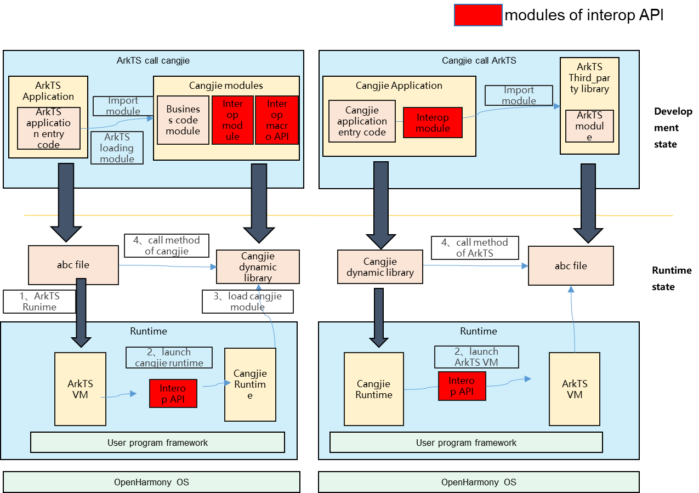

# Cangjie Interop API Public Repository

## Introduction

The Cangjie Interop API public Repository includes the common interfaces, interop macro interfaces, and JSON and CFFI interfaces provided by the Cangjie Interop Library, hoping to provide developers with cross-language interop solutions that take into account both development efficiency and operational efficiency, provide a simple interop development paradigm, and reduce cross-language interop overhead.

Framework architecture:


## Directory

```text
.
├── api                  # Public repository code for Cangjie Interop API
├── doc                   # Cangjie documentation including API reference, development guide and user manual
├── mocks                 # FFI mock stubs during SDK build
├── generate_mock.py      # Build script for generating mocks
├── bundle.json
└── LICENSE
```

## Usage Scenarios

It contains the Cangjie-ArkTS interoperation library, which is used for Cangjie-ArkTS interoperation. The json library/APILevel/cffi library are basic function libraries, providing public capabilities for subsystems such as Cangjie API/Cangjie UI.

### Typical scenario one: ArkTS calls Cangjie

For the demands of scenario one, an interoperability library can be used to implement an interface that can be interoperable and invoked on the Cangjie side. The example is as follows:

## Related Repositories

[cangjie_ark_interop](https://gitcode.com/Cangjie/cangjie-api/tree/dev)
