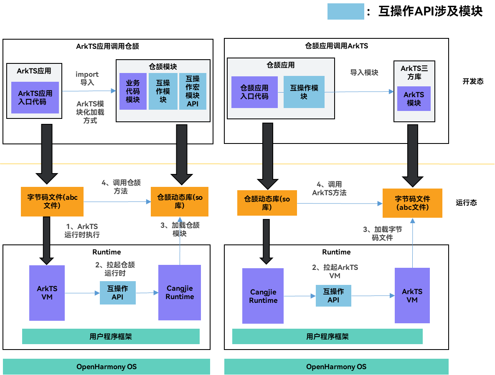

# 仓颉互操作 API 公共仓

## 简介

仓颉互操作 API 公共仓，包含仓颉互操作库提供的公共接口、互操作宏接口和依赖的 json 和 cffi 接口，期望给开发者提供兼顾开发效率和运行效率的跨语言互操作解决方案，提供简洁的互操作开发范式，降低跨语言互通开销。

其主要结构如下图所示：




## 目录

```text
.
├── api                  # 仓颉互操作 API 的公共仓代码
├── doc                   # 仓颉文档，包括api参考、应用开发指南、仓颉编程语言用户手册
├── mocks                 # sdk 构建时 ffi mock 桩
├── generate_mock.py      # 生成 mock 的构建脚本
├── bundle.json
└── LICENSE
```

## 使用场景

包含仓颉- ArkTS 互操作库，用于仓颉- ArkTS 互操作。json 库/ APILevel / cffi 库为基础功能库，提供给仓颉 api /仓颉 ui 等子系统等公共能力.

## 相关仓

[cangjie_ark_interop](https://gitcode.com/Cangjie/cangjie-api/tree/dev)
