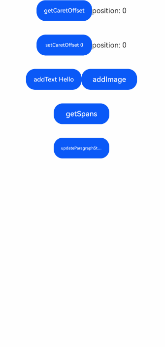

# ohos.arkui.component.rich_editor

支持图文混排和文本交互式编辑的组件。

## 导入模块

```cangjie
import kit.UIKit.*
```

## class LeadingMarginPlaceholder

```cangjie
public class LeadingMarginPlaceholder {
    public var pixelMap: PixelMap
    public var size:(Length, Length)
    public init(pixelMap!: PixelMap, size!: (Length, Length))
}
```

**功能：** 前导边距占位符，用于表示文本段落左侧与组件边缘之间的距离。

**系统能力：** SystemCapability.ArkUI.ArkUI.Full

**起始版本：** 21

### var pixelMap

```cangjie
public var pixelMap: PixelMap
```

**功能：** 图片内容。

**类型：** [PixelMap](../apis/ImageKit/cj-apis-image.md#class-pixelmap)

**读写能力：** 可读写

**系统能力：** SystemCapability.ArkUI.ArkUI.Full

**起始版本：** 21

### var size

```cangjie
public var size:(Length, Length)
```

**功能：** 图片大小，不支持设置百分比。

**类型：** ([Length](./cj-common-types.md#interface-length),[Length](./cj-common-types.md#interface-length))

**读写能力：** 可读写

**系统能力：** SystemCapability.ArkUI.ArkUI.Full

**起始版本：** 21

### init(PixelMap, (Length,Length))

```cangjie
public init(pixelMap!: PixelMap, size!: (Length, Length))
```

**功能：** 创建LeadingMarginPlaceholder类型的对象。

**系统能力：** SystemCapability.ArkUI.ArkUI.Full

**起始版本：** 21

**参数：**

|参数名|类型|必填|默认值|说明|
|:---|:---|:---|:---|:---|
|pixelMap|[PixelMap](../apis/ImageKit/cj-apis-image.md#class-pixelmap)|是|-|图片内容。|
|size|([Length](./cj-common-types.md#interface-length),[Length](./cj-common-types.md#interface-length))|是|-|图片大小，不支持设置百分比。|

## class RichEditorBaseController

```cangjie
public open class RichEditorBaseController {}
```

**功能：** RichEditor组件的控制器基类。

**系统能力：** SystemCapability.ArkUI.ArkUI.Full

**起始版本：** 21

### func getCaretOffset()

```cangjie
public func getCaretOffset(): Int64
```

**功能：** 获取当前光标所在位置。

**系统能力：** SystemCapability.ArkUI.ArkUI.Full

**起始版本：** 21

**返回值：**

|类型|说明|
|:----|:----|
|Int64|当前光标所在位置。|

### func setCaretOffset(Int64)

```cangjie
public func setCaretOffset(offset: Int64): Bool
```

**功能：** 设置光标位置。

**系统能力：** SystemCapability.ArkUI.ArkUI.Full

**起始版本：** 21

**参数：**

|参数名|类型|必填|默认值|说明|
|:---|:---|:---|:---|:---|
|offset|Int64|是|-|光标偏移位置。超出文本范围时，设置失败。|

**返回值：**

|类型|说明|
|:----|:----|
|Bool|光标是否设置成功。|

## class RichEditorController

```cangjie
public class RichEditorController <: RichEditorBaseController {
    public init()
}
```

**功能：** RichEditor组件的控制器。

**系统能力：** SystemCapability.ArkUI.ArkUI.Full

**起始版本：** 21

**父类型：**

- [RichEditorBaseController](#class-richeditorbasecontroller)

### init()

```cangjie
public init()
```

**功能：** 创建RichEditorController类型的对象。

**系统能力：** SystemCapability.ArkUI.ArkUI.Full

**起始版本：** 21

### func addImageSpan(String, RichEditorImageSpanOptions)

```cangjie
public func addImageSpan(value!: String, options!: RichEditorImageSpanOptions = RichEditorImageSpanOptions()): Int32
```

**功能：** 添加图片内容，如果组件光标闪烁，插入后光标位置更新为新插入图片的后面。

**系统能力：** SystemCapability.ArkUI.ArkUI.Full

**起始版本：** 21

**参数：**

|参数名|类型|必填|默认值|说明|
|:---|:---|:---|:---|:---|
|value|String|是|-|图片内容。|
|options|[RichEditorImageSpanOptions](#class-richeditorimagespanoptions)|否|RichEditorImageSpanOptions()|图片选项。|

**返回值：**

|类型|说明|
|:----|:----|
|Int32|添加完成的ImageSpan所在的位置。|

### func addImageSpan(AppResource, RichEditorImageSpanOptions)

```cangjie
public func addImageSpan(value!: AppResource, options!: RichEditorImageSpanOptions = RichEditorImageSpanOptions()): Int32
```

**功能：** 添加图片内容，如果组件光标闪烁，插入后光标位置更新为新插入图片的后面。

**系统能力：** SystemCapability.ArkUI.ArkUI.Full

**起始版本：** 21

**参数：**

|参数名|类型|必填|默认值|说明|
|:---|:---|:---|:---|:---|
|value|[AppResource](../apis/LocalizationKit/cj-apis-resource_manager.md#class-appresource)|是|-|图片内容。|
|options|[RichEditorImageSpanOptions](#class-richeditorimagespanoptions)|否|RichEditorImageSpanOptions()|图片选项。|

**返回值：**

|类型|说明|
|:----|:----|
|Int32|添加完成的ImageSpan所在的位置。|

### func addTextSpan(ResourceStr, RichEditorTextSpanOptions)

```cangjie
public func addTextSpan(value!: ResourceStr, options!: RichEditorTextSpanOptions = RichEditorTextSpanOptions()): Int32
```

**功能：** 添加文本内容，如果组件光标闪烁，插入后光标位置更新为新插入文本的后面。

**系统能力：** SystemCapability.ArkUI.ArkUI.Full

**起始版本：** 21

**参数：**

|参数名|类型|必填|默认值|说明|
|:---|:---|:---|:---|:---|
|value|[ResourceStr](../apis/LocalizationKit/cj-apis-resource_manager.md#class-resourcestr)|是|-|文本内容。|
|options|[RichEditorTextSpanOptions](#class-richeditortextspanoptions)|否|RichEditorTextSpanOptions()|文本选项。|

**返回值：**

|类型|说明|
|:----|:----|
|Int32|添加完成的TextSpan所在的位置。|

### func closeSelectionMenu()

```cangjie
public func closeSelectionMenu(): Unit
```

**功能：** 关闭自定义选择菜单或系统默认选择菜单。

**系统能力：** SystemCapability.ArkUI.ArkUI.Full

**起始版本：** 21

### func deleteSpans(Int32, Int32)

```cangjie
public func deleteSpans(start!: Int32 = 0, end!: Int32 = Int32.Max): Unit
```

**功能：** 删除指定范围内的文本和图片。

**系统能力：** SystemCapability.ArkUI.ArkUI.Full

**起始版本：** 21

**参数：**

|参数名|类型|必填|默认值|说明|
|:---|:---|:---|:---|:---|
|start|Int32|否|0|起始位置，省略或者设置负值时表示从0开始。|
|end|Int32|否|Int32.Max|结束位置，省略或者超出文本范围时表示到结尾。|

### func getSpans(Int32, Int32)

```cangjie
public func getSpans(start!: Int32 = -1, end!: Int32 = -1): ArrayList<RichEditorSpanResult>
```

**功能：** 获取Span信息。

**系统能力：** SystemCapability.ArkUI.ArkUI.Full

**起始版本：** 21

**参数：**

|参数名|类型|必填|默认值|说明|
|:---|:---|:---|:---|:---|
|start|Int32|否|-1|起始位置，省略或者设置负值时表示从0开始。|
|end|Int32|否|-1|结束位置，省略或者超出文本范围时表示无穷大。|

**返回值：**

|类型|说明|
|:----|:----|
|ArrayList\<[RichEditorSpanResult](#class-richeditorspanresult)>|存储span信息类型的数组。|

### func updateParagraphStyle(Int32, Int32, RichEditorParagraphStyle)

```cangjie
public func updateParagraphStyle(start!: Int32 = 0, end!: Int32 = -1, style!: RichEditorParagraphStyle): Unit
```

**功能：** 更新段落的样式。

**系统能力：** SystemCapability.ArkUI.ArkUI.Full

**起始版本：** 21

**参数：**

|参数名|类型|必填|默认值|说明|
|:---|:---|:---|:---|:---|
|start|Int32|否|0|需要更新样式的文本起始位置，省略或者设置负值时表示从0开始。|
|end|Int32|否|-1|需要更新样式的文本结束位置，省略或者超出文本范围时表示无穷大。|
|style|[RichEditorParagraphStyle](#class-richeditorparagraphstyle)|是|-|段落样式。|

### func updateSpanStyle(Int32, Int32, RichEditorTextStyle)

```cangjie
public func updateSpanStyle(start!: Int32 = 0, end!: Int32 = Int32.Max, textStyle!: RichEditorTextStyle): Unit
```

**功能：** 表示添加图片的偏移位置和图片样式信息的类型。

**系统能力：** SystemCapability.ArkUI.ArkUI.Full

**起始版本：** 21

**参数：**

|参数名|类型|必填|默认值|说明|
|:---|:---|:---|:---|:---|
|start|Int32|否|0|需要更新样式的文本起始位置，省略或者设置负值时表示从0开始。|
|end|Int32|否|Int32.Max|需要更新样式的文本结束位置，省略或者超出文本范围时表示无穷大。|
|textStyle|[RichEditorTextStyle](#class-richeditortextstyle)|是|-|文本样式。|

### func updateSpanStyle(Int32, Int32, RichEditorImageSpanStyle)

```cangjie
public func updateSpanStyle(start!: Int32 = 0, end!: Int32 = Int32.Max, imageStyle!: RichEditorImageSpanStyle): Unit
```

**功能：** 更新文本、图片或SymbolSpan样式。

**系统能力：** SystemCapability.ArkUI.ArkUI.Full

**起始版本：** 21

**参数：**

|参数名|类型|必填|默认值|说明|
|:---|:---|:---|:---|:---|
|start|Int32|否|0|需要更新样式的文本起始位置，省略或者设置负值时表示从0开始。|
|end|Int32|否|Int32.Max|需要更新样式的文本结束位置，省略或者超出文本范围时表示无穷大。|
|imageStyle|[RichEditorImageSpanStyle](#class-richeditorimagespanstyle)|是|-|图片样式。|

## class RichEditorImageSpanOptions

```cangjie
public class RichEditorImageSpanOptions {
    public var offset: Int32
    public var imageStyle: RichEditorImageSpanStyle
    public init(
        offset!: Int32 = Int32.Max,
        imageStyle!: RichEditorImageSpanStyle = RichEditorImageSpanStyle()
    )
}
```

**功能：** 表示添加图片的偏移位置和图片样式信息的类型。

**系统能力：** SystemCapability.ArkUI.ArkUI.Full

**起始版本：** 21

### var imageStyle

```cangjie
public var imageStyle: RichEditorImageSpanStyle
```

**功能：** 表示图片样式信息的类型。省略时，使用系统默认图片信息。

**类型：** [RichEditorImageSpanStyle](#class-richeditorimagespanstyle)

**读写能力：** 可读写

**系统能力：** SystemCapability.ArkUI.ArkUI.Full

**起始版本：** 21

### var offset

```cangjie
public var offset: Int32
```

**功能：** 表示添加图片的位置。省略时，添加到所有文本字符串的最后。当值小于0时，放在字符串最前面；当值大于字符串长度时，放在字符串最后面。

**类型：** Int32

**读写能力：** 可读写

**系统能力:** SystemCapability.ArkUI.ArkUI.Full

**起始版本：** 21

### init(Int32, RichEditorImageSpanStyle)

```cangjie
public init(
    offset!: Int32 = Int32.Max,
    imageStyle!: RichEditorImageSpanStyle = RichEditorImageSpanStyle()
)
```

**功能：** 创建RichEditorImageSpanOptions类型的对象。

**系统能力：** SystemCapability.ArkUI.ArkUI.Full

**起始版本：** 21

**参数：**

|参数名|类型|必填|默认值|说明|
|:---|:---|:---|:---|:---|
|offset|Int32|否|Int32.Max|添加图片的位置。省略时，添加到所有文本字符串的最后。当值小于0时，放在字符串最前面；当值大于字符串长度时，放在字符串最后面。|
|imageStyle|[RichEditorImageSpanStyle](#class-richeditorimagespanstyle)|否|RichEditorImageSpanStyle()|图片样式信息。省略时，使用系统默认图片信息。|

## class RichEditorImageSpanStyle

```cangjie
public class RichEditorImageSpanStyle {
    public var size: Option <(Length, Length)>
    public var verticalAlign: ImageSpanAlignment
    public var objectFit: ImageFit
    public init(
        size!: (Length, Length),
        verticalAlign!: ImageSpanAlignment = ImageSpanAlignment.Baseline,
        objectFit!: ImageFit = ImageFit.Cover
    )
    public init(
        verticalAlign!: ImageSpanAlignment = ImageSpanAlignment.Baseline,
        objectFit!: ImageFit = ImageFit.Cover
    )
}
```

**功能：** 图片样式。

**系统能力：** SystemCapability.ArkUI.ArkUI.Full

**起始版本：** 21

### var objectFit

```cangjie
public var objectFit: ImageFit
```

**功能：** 图片缩放类型。

**类型：** [ImageFit](./cj-common-types.md#enum-imagefit)

**读写能力：** 可读写

**系统能力：** SystemCapability.ArkUI.ArkUI.Full

**起始版本：** 21

### var size

```cangjie
public var size: Option <(Length, Length)>
```

**功能：** 图片宽度和高度。

**类型：** [Option](../apis/BasicDataTypeKit/cj-apis-container.md#class-option)\<([Length](./cj-common-types.md#interface-length),[Length](./cj-common-types.md#interface-length))>

**读写能力：** 可读写

**系统能力：** SystemCapability.ArkUI.ArkUI.Full

**起始版本：** 21

### var verticalAlign

```cangjie
public var verticalAlign: ImageSpanAlignment
```

**功能：** 图片垂直对齐方式。

**类型：** [ImageSpanAlignment](./cj-common-types.md#enum-imagespanalignment)

**读写能力：** 可读写

**系统能力：** SystemCapability.ArkUI.ArkUI.Full

**起始版本：** 21

### init((Length,Length), ImageSpanAlignment, ImageFit)

```cangjie
public init(
    size!: (Length, Length),
    verticalAlign!: ImageSpanAlignment = ImageSpanAlignment.Baseline,
    objectFit!: ImageFit = ImageFit.Cover
)
```

**功能：** 创建RichEditorImageSpanStyle类型的对象。

**系统能力：** SystemCapability.ArkUI.ArkUI.Full

**起始版本：** 21

**参数：**

|参数名|类型|必填|默认值|说明|
|:---|:---|:---|:---|:---|
|size|([Length](./cj-common-types.md#interface-length),[Length](./cj-common-types.md#interface-length))|是|-|图片宽度和高度。|
|verticalAlign|[ImageSpanAlignment](./cj-common-types.md#enum-imagespanalignment)|否|ImageSpanAlignment.Baseline|图片垂直对齐方式。|
|objectFit|[ImageFit](./cj-common-types.md#enum-imagefit)|否|ImageFit.Cover|图片缩放类型。|

### init(ImageSpanAlignment, ImageFit)

```cangjie
public init(
    verticalAlign!: ImageSpanAlignment = ImageSpanAlignment.Baseline,
    objectFit!: ImageFit = ImageFit.Cover
)
```

**功能：** 创建RichEditorImageSpanStyle类型的对象。

**系统能力：** SystemCapability.ArkUI.ArkUI.Full

**起始版本：** 21

**参数：**

|参数名|类型|必填|默认值|说明|
|:---|:---|:---|:---|:---|
|verticalAlign|[ImageSpanAlignment](./cj-common-types.md#enum-imagespanalignment)|否|ImageSpanAlignment.Baseline|图片垂直对齐方式。|
|objectFit|[ImageFit](./cj-common-types.md#enum-imagefit)|否|ImageFit.Cover|图片缩放类型。|

## class RichEditorLayoutStyle

```cangjie
public class RichEditorLayoutStyle {
    public var margin: Margin
    public var borderRadius: BorderRadiuses
    public init(margin!: Margin = Margin(), borderRadius!: BorderRadiuses = BorderRadiuses())
    public init(margin!: Length, borderRadius!: Length)
}
```

**功能：** 图片布局风格。

**系统能力：** SystemCapability.ArkUI.ArkUI.Full

**起始版本：** 21

### var borderRadius

```cangjie
public var borderRadius: BorderRadiuses
```

**功能：** 圆角类型，用于描述组件边框圆角半径。

**类型：** [BorderRadiuses](./cj-common-types.md#class-borderradiuses)

**读写能力：** 可读写

### var margin

```cangjie
public var margin: Margin
```

**功能：** 外边距类型，用于描述组件不同方向的外边距。

**类型：** [Margin](./cj-common-types.md#class-margin)

**读写能力：** 可读写

### init(Margin, BorderRadiuses)

```cangjie
public init(margin!: Margin = Margin(), borderRadius!: BorderRadiuses = BorderRadiuses())
```

**功能：** 创建RichEditorLayoutStyle类型的对象。

**系统能力：** SystemCapability.ArkUI.ArkUI.Full

**起始版本：** 21

**参数：**

|参数名|类型|必填|默认值|说明|
|:---|:---|:---|:---|:---|
|margin|[Margin](./cj-common-types.md#class-margin)|否|Margin()|外边距类型。|
|borderRadius|[BorderRadiuses](./cj-common-types.md#class-borderradiuses)|否|BorderRadiuses()|圆角类型。|

### init(Length, Length)

```cangjie
public init(margin!: Length, borderRadius!: Length)
```

**功能：** 创建RichEditorLayoutStyle类型的对象。

**系统能力：** SystemCapability.ArkUI.ArkUI.Full

**起始版本：** 21

**参数：**

|参数名|类型|必填|默认值|说明|
|:---|:---|:---|:---|:---|
|margin|[Length](./cj-common-types.md#interface-length)|是|-|外边距值。|
|borderRadius|[Length](./cj-common-types.md#interface-length)|是|-|圆角半径值。|

## class RichEditorParagraphStyle

```cangjie
public class RichEditorParagraphStyle {
    public var textAlign: TextAlign
    public var leadingMargin: LeadingMarginType
    public init(textAlign!: TextAlign = TextAlign.Start)
    public init(textAlign!: TextAlign = TextAlign.Start, leadingMargin!: Length)
    public init(textAlign!: TextAlign = TextAlign.Start, leadingMargin!: LeadingMarginPlaceholder)
}
```

**功能：** 段落样式。

**系统能力：** SystemCapability.ArkUI.ArkUI.Full

**起始版本：** 21

### var leadingMargin

```cangjie
public var leadingMargin: LeadingMarginType
```

**功能：** 表示文本段落缩进。

**类型：** [LeadingMarginType](#enum-leadingmargintype)

**读写能力：** 可读写

**系统能力：** SystemCapability.ArkUI.ArkUI.Full

**起始版本：** 21

### var textAlign

```cangjie
public var textAlign: TextAlign
```

**功能：** 表示文本段落在水平方向的对齐方式。

**类型:** [TextAlign](./cj-common-types.md#enum-textalign)

**读写能力：** 可读写

**系统能力：** SystemCapability.ArkUI.ArkUI.Full

**起始版本：** 21

### init(TextAlign)

```cangjie
public init(textAlign!: TextAlign = TextAlign.Start)
```

**功能：** 创建RichEditorParagraphStyle类型的对象。

**系统能力：** SystemCapability.ArkUI.ArkUI.Full

**起始版本：** 21

**参数：**

|参数名|类型|必填|默认值|说明|
|:---|:---|:---|:---|:---|
|textAlign|[TextAlign](./cj-common-types.md#enum-textalign)|否|TextAlign.Start|文本段落在水平方向的对齐方式。|

### init(TextAlign, Length)

```cangjie
public init(textAlign!: TextAlign = TextAlign.Start, leadingMargin!: Length)
```

**功能：** 创建RichEditorParagraphStyle类型的对象。

**系统能力：** SystemCapability.ArkUI.ArkUI.Full

**起始版本：** 21

**参数：**

|参数名|类型|必填|默认值|说明|
|:---|:---|:---|:---|:---|
|textAlign|[TextAlign](./cj-common-types.md#enum-textalign)|否|TextAlign.Start|文本段落在水平方向的对齐方式。|
|leadingMargin|[Length](./cj-common-types.md#interface-length)|是|-|文本段落缩进，不支持设置百分比。|

### init(TextAlign, LeadingMarginPlaceholder)

```cangjie
public init(textAlign!: TextAlign = TextAlign.Start, leadingMargin!: LeadingMarginPlaceholder)
```

**功能：** 创建RichEditorParagraphStyle类型的对象。

**系统能力：** SystemCapability.ArkUI.ArkUI.Full

**起始版本：** 21

**参数：**

|参数名|类型|必填|默认值|说明|
|:---|:---|:---|:---|:---|
|textAlign|[TextAlign](./cj-common-types.md#enum-textalign)|否|TextAlign.Start|文本段落在水平方向的对齐方式。|
|leadingMargin|[LeadingMarginPlaceholder](#class-leadingmarginplaceholder)|是|-|文本段落缩进，不支持设置百分比。|

## class RichEditorTextSpanOptions

```cangjie
public class RichEditorTextSpanOptions {
    public var offset: Int32
    public var style: RichEditorTextStyle
    public init(offset!: Int32 = Int32.Max, style!: RichEditorTextStyle = RichEditorTextStyle())
}
```

**功能：** 添加文本的偏移位置和文本样式信息。

**系统能力：** SystemCapability.ArkUI.ArkUI.Full

**起始版本：** 21

### var offset

```cangjie
public var offset: Int32
```

**功能：** 表示添加文本的位置。省略时，添加到所有文本字符串的最后。当值小于0时，放在字符串最前面；当值大于字符串长度时，放在字符串最后面。

**类型：** Int32

**读写能力：** 可读写

**系统能力：** SystemCapability.ArkUI.ArkUI.Full

**起始版本：** 21

### var style

```cangjie
public var style: RichEditorTextStyle
```

**功能：** 表示文本样式信息的类型。省略时，使用系统默认文本信息。

**类型：** [RichEditorTextStyle](#class-richeditortextstyle)

**读写能力:** 可读写

**系统能力：** SystemCapability.ArkUI.ArkUI.Full

**起始版本：** 21

### init(Int32, RichEditorTextStyle)

```cangjie
public init(offset!: Int32 = Int32.Max, style!: RichEditorTextStyle = RichEditorTextStyle())
```

**功能：** 创建RichEditorTextSpanOptions类型的对象。

**系统能力：** SystemCapability.ArkUI.ArkUI.Full

**起始版本：** 21

**参数：**

|参数名|类型|必填|默认值|说明|
|:---|:---|:---|:---|:---|
|offset|Int32|否|Int32.Max|添加文本的位置。省略时，添加到所有文本字符串的最后。当值小于0时，放在字符串最前面；当值大于字符串长度时，放在字符串最后面。|
|style|[RichEditorTextStyle](#class-richeditortextstyle)|否|RichEditorTextStyle()|文本样式信息。省略时，使用系统默认文本信息。|

## class RichEditorTextStyle

```cangjie
public class RichEditorTextStyle {
    public var fontColor: ResourceColor
    public var fontSize: Length
    public var fontStyle: FontStyle
    public var fontWeight: FontWeight
    public var fontFamily: ResourceStr
    public var decoration: TextDecorationOptions
    public init(
        fontColor!: ResourceColor = Color.Black,
        fontSize!: Length = 16.vp,
        fontStyle!: FontStyle = FontStyle.Normal,
        fontWeight!: FontWeight = FontWeight.Normal,
        fontFamily!: ResourceStr = DEFAULT_FONT,
        decoration!: TextDecorationOptions = TextDecorationOptions(decorationType: TextDecorationType.None, color: Color.Black)
    )
}
```

**功能：** 文本样式信息。

**系统能力：** SystemCapability.ArkUI.ArkUI.Full

**起始版本：** 21

### var decoration

```cangjie
public var decoration: TextDecorationOptions
```

**功能：** 文本装饰线样式及其颜色。

**类型：** [TextDecorationOptions](#class-textdecorationoptions)

**读写能力：** 可读写

**系统能力：** SystemCapability.ArkUI.ArkUI.Full

**起始版本：** 21

### var fontColor

```cangjie
public var fontColor: ResourceColor
```

**功能：** 文本颜色。

**类型：** [ResourceColor](./cj-common-types.md#interface-resourcecolor)

**读写能力：** 可读写

**系统能力：** SystemCapability.ArkUI.ArkUI.Full

**起始版本：** 21

### var fontFamily

```cangjie
public var fontFamily: ResourceStr
```

**功能：** 字体列表。

**类型：** [ResourceStr](./cj-common-types.md#interface-resourcestr)

**读写能力：** 可读写

**系统能力：** SystemCapability.ArkUI.ArkUI.Full

**起始版本：** 21

### var fontSize

```cangjie
public var fontSize: Length
```

**功能：** 字体大小，Length为Int64、Float64类型时，使用fp单位。不支持百分比设置。

**类型：** [Length](./cj-common-types.md#interface-length)

**读写能力：** 可读写

**系统能力：** SystemCapability.ArkUI.ArkUI.Full

**起始版本：** 21

### var fontStyle

```cangjie
public var fontStyle: FontStyle
```

**功能：** 字体样式。

**类型：** [FontStyle](./cj-common-types.md#enum-fontstyle)

**读写能力：** 可读写

**系统能力：** SystemCapability.ArkUI.ArkUI.Full

**起始版本:** 21

### var fontWeight

```cangjie
public var fontWeight: FontWeight
```

**功能：** 字体粗细。

**类型：** [FontWeight](./cj-common-types.md#enum-fontweight)

**读写能力：** 可读写

**系统能力：** SystemCapability.ArkUI.ArkUI.Full

**起始版本：** 21

### init(ResourceColor, Length, FontStyle, FontWeight, ResourceStr, TextDecorationOptions)

```cangjie
public init(
    fontColor!: ResourceColor = Color.Black,
    fontSize!: Length = 16.vp,
    fontStyle!: FontStyle = FontStyle.Normal,
    fontWeight!: FontWeight = FontWeight.Normal,
    fontFamily!: ResourceStr = DEFAULT_FONT,
    decoration!: TextDecorationOptions = TextDecorationOptions(decorationType: TextDecorationType.None, color: Color.Black)
)
```

**功能：** 创建RichEditorTextStyle类型的对象。

**系统能力：** SystemCapability.ArkUI.ArkUI.Full

**起始版本：** 21

**参数：**

|参数名|类型|必填|默认值|说明|
|:---|:---|:---|:---|:---|
|fontColor|[ResourceColor](./cj-common-types.md#interface-resourcecolor)|否|Color.Black|文本颜色。|
|fontSize|[Length](./cj-common-types.md#interface-length)|否|16.vp|字体大小，Length为Int64、Float64类型时，使用fp单位。不支持百分比设置。|
|fontStyle|[FontStyle](./cj-common-types.md#enum-fontstyle)|否|FontStyle.Normal|字体样式。|
|fontWeight|[FontWeight](./cj-common-types.md#enum-fontweight)|否|FontWeight.Normal|字体粗细。|
|fontFamily|[ResourceStr](./cj-common-types.md#interface-resourcestr)|否|DEFAULT_FONT|字体列表。|
|decoration|[TextDecorationOptions](#class-textdecorationoptions)|否|TextDecorationOptions(decorationType: TextDecorationType.None, color: Color.Black)|文本装饰线样式及其颜色。|

## class SelectionMenuOptions

```cangjie
public class SelectionMenuOptions {
    public var onAppear: VoidCallback
    public var onDisappear: VoidCallback
    public init(onAppear!: () -> Unit = {=>}, onDisappear!: () -> Unit = {=>})
}
```

**功能：** 菜单选项类型。

**系统能力：** SystemCapability.ArkUI.ArkUI.Full

**起始版本：** 21

### var onAppear

```cangjie
public var onAppear: VoidCallback
```

**功能：** 回调函数，自定义选择菜单弹出时触发回调函数。

**类型：** [VoidCallback](../apis/BasicDataTypeKit/cj-apis-container.md#class-voidcallback)

**读写能力：** 可读写

**系统能力：** SystemCapability.ArkUI.ArkUI.Full

**起始版本：** 21

### var onDisappear

```cangjie
public var onDisappear: VoidCallback
```

**功能：** 回调函数，自定义选择菜单关闭时触发回调函数。

**类型：** [VoidCallback](../apis/BasicDataTypeKit/cj-apis-container.md#class-voidcallback)

**读写能力：** 可读写

**系统能力：** SystemCapability.ArkUI.ArkUI.Full

**起始版本：** 21

### init(() -> Unit, () -> Unit)

```cangjie
public init(onAppear!: () -> Unit = {=>}, onDisappear!: () -> Unit = {=>})
```

**功能：** 创建SelectionMenuOptions类型的对象。

**系统能力：** SystemCapability.ArkUI.ArkUI.Full

**起始版本：** 21

**参数：**

|参数名|类型|必填|默认值|说明|
|:---|:---|:---|:---|:---|
|onAppear|()->Unit|否|{ => }|回调函数，自定义选择菜单弹出时触发回调函数。|
|onDisappear|()->Unit|否|{ => }|回调函数，自定义选择菜单关闭时触发回调函数。|

## class TextDecorationOptions

```cangjie
public class TextDecorationOptions {
    public var decorationType: TextDecorationType
    public var color: ResourceColor
    public init(decorationType!: TextDecorationType, color!: ResourceColor = Color.Black)
}
```

**功能：** <font color="red" face="bold">please add description</font>

**系统能力：** SystemCapability.ArkUI.ArkUI.Full

**起始版本：** 21

### var color

```cangjie
public var color: ResourceColor
```

**功能：** <font color="red" face="bold">please add description</font>

**类型：** [ResourceColor](./cj-common-types.md#interface-resourcecolor)

**读写能力：** 可读写

**系统能力：** SystemCapability.ArkUI.ArkUI.Full

**起始版本：** 21

### var decorationType

```cangjie
public var decorationType: TextDecorationType
```

**功能：** <font color="red" face="bold">please add description</font>

**类型：** [TextDecorationType](./cj-common-types.md#enum-textdecorationtype)

**读写能力：** 可读写

**系统能力：** SystemCapability.ArkUI.ArkUI.Full

**起始版本：** 21

### init(TextDecorationType, ResourceColor)

```cangjie
public init(decorationType!: TextDecorationType, color!: ResourceColor = Color.Black)
```

**功能：** <font color="red" face="bold">please add description</font>

**系统能力：** SystemCapability.ArkUI.ArkUI.Full

**起始版本：** 21

**参数：**

|参数名|类型|必填|默认值|说明|
|:---|:---|:---|:---|:---|
|decorationType|[TextDecorationType](./cj-common-types.md#enum-textdecorationtype)|是|-|装饰线类型。|
|color|[ResourceColor](./cj-common-types.md#interface-resourcecolor)|否|Color.Black|装饰颜色。|

## enum LeadingMarginType

```cangjie
public enum LeadingMarginType {
    | LengthType(Length)
    | PlaceholderType(LeadingMarginPlaceholder)
    | None
    | ...
}
```

**功能：** <font color="red" face="bold">please add description</font>

**系统能力：** SystemCapability.ArkUI.ArkUI.Full

**起始版本：** 21

### LengthType(Length)

```cangjie
LengthType(Length)
```

**功能：** <font color="red" face="bold">please add description</font>

**系统能力：** SystemCapability.ArkUI.ArkUI.Full

**起始版本：** 21

### None

```cangjie
None
```

**功能：** <font color="red" face="bold">please add description</font>

**系统能力：** SystemCapability.ArkUI.ArkUI.Full

**起始版本：** 21

### PlaceholderType(LeadingMarginPlaceholder)

```cangjie
PlaceholderType(LeadingMarginPlaceholder)
```

**功能：** <font color="red" face="bold">please add description</font>

**系统能力：** SystemCapability.ArkUI.ArkUI.Full

**起始版本：** 21

## 示例代码

<!-- run -->

```cangjie
package ohos_app_cangjie_entry
import kit.ArkUI.*
import ohos.arkui.state_macro_manage.*
import kit.LocalizationKit.*
import kit.PerformanceAnalysisKit.*

@Entry
@Component
class EntryView {
    let controller = RichEditorController()

    @State var position: Int64 = 0

    @Builder
    func builder(){
        Column {
            ForEach(["1", "2", "3", "4", "5", "6", "7", "8", "9", "*", "0", "#"], itemGeneratorFunc: {item: String, idx: Int64 =>
                Button(item)
                .width(40.vp)
                .height(40.vp)
                .fontColor(0x66000000)
                .fontSize(16.fp)
            })
        }
        .borderRadius(24.vp)
        .padding(top: 4.vp, bottom: 4.vp, left: 16.vp, right: 16.vp)
        .backgroundColor(Color.Green)
        .margin(right: 24.vp, bottom: 4.vp, top: 0.vp)
        .width(130.vp)
    }

    func build() {
        Column(space: 30) {
            Row {
                Button("getCaretOffset")
                .onClick {
                    evt =>
                    Hilog.info(0, "AppLogCj", controller.getCaretOffset().toString())
                    this.position = controller.getCaretOffset()
                }.width(400.px).height(150.px)

                Text("position: ${this.position.toString()}")
            }

            Row {
                Button("setCaretOffset 0")
                .onClick {
                    evt =>
                    controller.setCaretOffset(0)
                }.width(400.px).height(150.px)

                Text("position: ${this.position.toString()}")
            }

            Row {
                Button("addText Hello")
                .onClick {
                    evt =>
                    controller.addTextSpan(
                        value: "Hello",
                        options: RichEditorTextSpanOptions(
                            style: RichEditorTextStyle(
                                fontColor: Color(0XFF1298),
                                fontSize: 20.fp,
                                fontStyle: FontStyle.Italic,
                                decoration: TextDecorationOptions(
                                    decorationType: TextDecorationType.Overline,
                                    color: Color(0X12FF98)
                                ),
                            )
                        )
                    )
                }.width(400.px).height(150.px)

                Button("addImage")
                .onClick {
                    evt =>
                    controller.addImageSpan(
                        value: @r(app.media.startIcon),
                        options: RichEditorImageSpanOptions(
                            imageStyle: RichEditorImageSpanStyle(
                                size: (24.vp, 24.vp)
                            )
                        )
                    )
                }.width(400.px).height(150.px)
            }

            Row {
                Button("updateParagraphStyle")
                .onClick {
                    evt =>
                    let array = controller.updateParagraphStyle(
                        start: 0,
                        end: 100,
                        style: RichEditorParagraphStyle(
                            textAlign: TextAlign.Center,
                            leadingMargin: 24.px
                        )
                    )
                }.width(400.px).height(150.px)
            }

            RichEditor(controller)
            .customKeyboard(value: bind(builder, this))
            .bindSelectionMenu(
                spantype: RichEditorSpanType.Text,
                content: bind(builder, this),
                responseType: ResponseType.LongPress,
                options: SelectionMenuOptions(onAppear: { => Hilog.info(0, "AppLogCj", "SelectionMenuOptions onAppear")}, onDisappear: { => Hilog.info(0, "AppLogCj", "SelectionMenuOptions onDisappear")})
            )
            .copyOptions(CopyOptions.None)
            .onReady({ => Hilog.info(0, "AppLogCj", "RichEditor onReady!!")})
            .onDeleteComplete({ => Hilog.info(0, "AppLogCj", "RichEditor onDeleteComplete!!")})
            .onSelect({ value =>
                Hilog.info(0, "AppLogCj", "RichEditor onSelect. ${value.selection[0]} ~ ${value.selection[1]}")
            })
        }
    }
}
```

